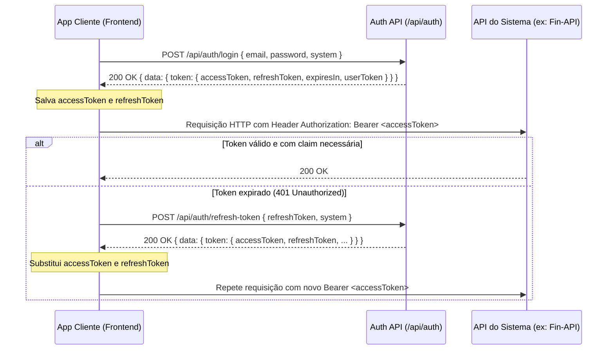

# Guia de Integração para Aplicações Clientes — Auth API

Este documento descreve como integrar um novo sistema (Frontend Web/Mobile e Backend satélite) ao serviço central de autenticação (**Auth API**), detalhando os pré-requisitos, fluxos e contratos JSON de **Login**, **Refresh Token**, **Criação/Vínculo de Usuário** e **Recuperação/Redefinição de Senha**.

---

## 1. Pré-requisitos (Configuração do Novo Sistema)

Antes de integrar um aplicativo cliente (ex.: sistema `FIN` ou `CRM`), realize os seguintes passos:

1. **Cadastrar o Sistema no Painel Admin (`Auth.Client` em `/sistemas`):**
   - Crie o sistema informando **Nome** (ex.: `FIN`) e **URL** (ex.: `https://fin.seudominio.com`).
2. **Criar Perfis (Roles) e Permissões (Claims):**
   - Dentro do sistema criado, adicione ao menos uma **Role** (ex.: `Basico`, `Admin`).
   - Adicione as **Claims** na role seguindo obrigatoriamente o padrão **`SISTEMA:ACAO`** (sempre em maiúsculas):
     - Exemplos: `FIN:LER`, `FIN:TRN_CRIAR`, `CRM:CLIENTE_EDITAR`.
   - ⚠️ **Regra de Login:** Para que um usuário consiga fazer login em um sistema (`"system": "FIN"`), o perfil dele deve possuir **ao menos uma claim** do tipo `"permission"` começando com `"FIN:"`.
3. **Configurar CORS na Auth API:**
   - Adicione a URL do frontend cliente no array `FrontEndSettings:AllowedApps` (ou variáveis `FrontEndSettings__AllowedApps__0`, `FrontEndSettings__AllowedApps__1`, etc.).

---

## 2. Padrão de Resposta da API (Envelope)

Todos os endpoints da Auth API utilizam o mesmo envelope JSON:

### Sucesso (`HTTP 200 OK`)
```json
{
  "success": true,
  "data": { ... }
}
```

### Erro de Negócio ou Validação (`HTTP 400 Bad Request`)
```json
{
  "success": false,
  "errors": [
    "usuário ou senha incorretos!"
  ]
}
```

---

## 3. Contratos dos Endpoints (`/api/auth`)

### 3.1 Login — `POST /api/auth/login`

Autentica o usuário, valida se ele possui permissão para o sistema informado e emite um par `accessToken` (JWT assinado via JWKS, válido por **1 hora**) + `refreshToken`.

#### Request (`application/json`)
| Campo | Tipo | Obrigatório | Regras de Validação |
| :--- | :--- | :---: | :--- |
| `email` | `string` | Sim | Formato de e-mail válido |
| `password` | `string` | Sim | Entre `6` e `100` caracteres |
| `system` | `string` | Sim | Identificador/prefixo do sistema (ex.: `"FIN"`) |

```json
{
  "email": "usuario@empresa.com",
  "password": "Password@123",
  "system": "FIN"
}
```

#### Response `200 OK`
> **Atenção:** O objeto de sessão fica dentro de `data.token`.

```json
{
  "success": true,
  "data": {
    "token": {
      "accessToken": "eyJhbGciOiJSUzI1NiIsImtpZCI6Ij...",
      "refreshToken": "6c85f2a9-4e1a-4b10-9f5c-1a2b3c4d5e6f",
      "expiresIn": 3600,
      "userToken": {
        "id": "e4b7d1a2-9c3f-4e8a-b1d2-3c4d5e6f7a8b",
        "name": "usuario@empresa.com",
        "claims": [
          {
            "type": "permission",
            "value": "FIN:LER"
          },
          {
            "type": "permission",
            "value": "FIN:TRN_CRIAR"
          },
          {
            "type": "http://schemas.xmlsoap.org/ws/2005/05/identity/claims/nameidentifier",
            "value": "e4b7d1a2-9c3f-4e8a-b1d2-3c4d5e6f7a8b"
          }
        ]
      }
    }
  }
}
```

#### Possíveis Erros (`400 Bad Request`)
- `"usuário ou senha incorretos!"` (credenciais inválidas ou conta temporariamente bloqueada por tentativas falhas).
- `"Sistema não encontrado!"` (o `system` informado não existe na base).
- `"Usuário não tem permissão nesse sistema!"` (usuário existe, mas não possui nenhuma claim com prefixo `"{SYSTEM}:"`).

---

### 3.2 Renovação de Token (Refresh Token) — `POST /api/auth/refresh-token`

Emite um novo `accessToken` e **rotaciona** o `refreshToken` (o `refreshToken` anterior é invalidado e substituído pelo novo).

#### Request (`application/json`)
| Campo | Tipo | Obrigatório | Regras de Validação |
| :--- | :--- | :---: | :--- |
| `refreshToken` | `string (GUID)` | Sim | GUID recebido no último login ou refresh |
| `system` | `string` | Sim | Identificador/prefixo do sistema (ex.: `"FIN"`) |

```json
{
  "refreshToken": "6c85f2a9-4e1a-4b10-9f5c-1a2b3c4d5e6f",
  "system": "FIN"
}
```

#### Response `200 OK`
Retorna exatamente a mesma estrutura do Login (`data.token`):

```json
{
  "success": true,
  "data": {
    "token": {
      "accessToken": "eyJhbGciOiJSUzI1NiIsImtpZCI6Ij...",
      "refreshToken": "9a12b3c4-5d6e-7f8a-9b0c-1d2e3f4a5b6c",
      "expiresIn": 3600,
      "userToken": {
        "id": "e4b7d1a2-9c3f-4e8a-b1d2-3c4d5e6f7a8b",
        "name": "usuario@empresa.com",
        "claims": [ ... ]
      }
    }
  }
}
```

#### Possíveis Erros (`400 Bad Request`)
- `"Refresh token inválido"` (formato inválido ou campos vazios).
- `"Refresh Token expirado"` (token não encontrado, já utilizado ou expirado).

---

### 3.3 Criação / Vínculo de Usuário — `POST /api/auth/registrar`

Cadastra um novo usuário no ecossistema **ou** vincula um usuário já existente (de outro sistema) a um perfil no sistema atual.

#### Comportamento de Negócio
1. **E-mail ainda não existe na Auth API:**
   - Cria o usuário no Identity, envia o evento `UsuarioRegistradoIntegrationEvent` via RabbitMQ (RPC `RequestAsync`) para o backend consumidor e associa a role (`profile`) do sistema (`system`).
   - Caso a validação no RabbitMQ falhe, o usuário recém-criado sofre *rollback* automático.
2. **E-mail já existe em outro sistema do ecossistema:**
   - O usuário deve informar **a mesma senha atual** da conta dele.
   - Se a senha conferir e ele ainda não possuir a role informada naquele sistema, o vínculo é criado mantendo o mesmo `userId` único entre todos os sistemas.

#### Request (`application/json`)
| Campo | Tipo | Obrigatório | Regras de Validação |
| :--- | :--- | :---: | :--- |
| `nome` | `string` | Sim | Entre `2` e `50` caracteres |
| `email` | `string` | Sim | Formato de e-mail válido |
| `password` | `string` | Sim | Entre `6` e `100` caracteres (requisitos do Identity: maiúscula, minúscula, número e caractere especial) |
| `confirmPassword` | `string` | Sim | Deve ser idêntico a `password` |
| `system` | `string` | Sim | Nome ou prefixo do sistema cadastrado (ex.: `"FIN"`) |
| `profile` | `string` | Sim | Nome da Role cadastrada para aquele sistema (ex.: `"Basico"`) |

```json
{
  "nome": "Maria Silva",
  "email": "maria.silva@empresa.com",
  "password": "Password@123",
  "confirmPassword": "Password@123",
  "system": "FIN",
  "profile": "Basico"
}
```

#### Response `200 OK`
Retorna o `id` (`GUID` em string) do usuário criado/vinculado em `data`:

```json
{
  "success": true,
  "data": "e4b7d1a2-9c3f-4e8a-b1d2-3c4d5e6f7a8b"
}
```

#### Possíveis Erros (`400 Bad Request`)
- `"Perfil não encontrado para o sistema informado!"`
- `"A senha deve ser a mesma do outro sistema para a liberação de permissão!"`
- `"O usuário ja tem esse perfil!"`
- `"Falha ao registrar o usuário!"` / `"Erro ao cadastrar usuário no sistema"`

---

### 3.4 Solicitar Recuperação de Senha — `POST /api/auth/forgot-password`

Gera um token de redefinição de senha no Identity e publica um `EmailIntegrationEvent` (`Type = "RESET"`) no RabbitMQ contendo o link de redefinição:

```text
{FrontEndSettings:AllowedApps[0]}/auth?email={email_url_encoded}&token={token_url_encoded}
```

> **Segurança (Anti-enumeração):** Caso o e-mail não exista na base, o endpoint ainda retorna `200 OK` (`data: true`) sem disparar e-mail.

#### Request (`application/json`)
| Campo | Tipo | Obrigatório | Regras de Validação |
| :--- | :--- | :---: | :--- |
| `email` | `string` | Sim | Formato de e-mail válido |

```json
{
  "email": "usuario@empresa.com"
}
```

#### Response `200 OK`
```json
{
  "success": true,
  "data": true
}
```

---

### 3.5 Redefinir Senha — `POST /api/auth/reset-pass`

Aplica a nova senha utilizando o `email` e o `token` recebidos na URL do link de recuperação (`/auth?email=...&token=...`).

> **Importante para o Frontend:** Ao extrair `email` e `token` da query string da URL (`?email=...&token=...`), utilize `decodeURIComponent` (ou `URLSearchParams`, que já decodifica automaticamente) antes de enviar no JSON para `POST /api/auth/reset-pass`, pois o token do Identity contém caracteres especiais como `+` e `/`.

#### Request (`application/json`)
| Campo | Tipo | Obrigatório | Regras de Validação |
| :--- | :--- | :---: | :--- |
| `token` | `string` | Sim | Token recebido por e-mail (decodificado da URL) |
| `email` | `string` | Sim | E-mail do usuário |
| `password` | `string` | Sim | Nova senha (entre `6` e `100` caracteres) |
| `confirmPassword` | `string` | Sim | Deve ser idêntico a `password` |

```json
{
  "token": "CfDJ8N...==",
  "email": "usuario@empresa.com",
  "password": "NovaPassword@123",
  "confirmPassword": "NovaPassword@123"
}
```

#### Response `200 OK`
```json
{
  "success": true,
  "data": true
}
```

#### Possíveis Erros (`400 Bad Request`)
- `"Email inválido!"`
- `"Usuário não encontrado!"`
- `"token inválido"`
- `"Houve um erro atualizando a senha!"` (token expirado, já utilizado ou senha fora do padrão de complexidade).

---

## 4. Fluxo Recomendado no App Cliente (Frontend Web / Mobile)



---

## 5. Como Proteger o Backend do Sistema Satélite (.NET + JWKS)

A Auth API expõe automaticamente suas chaves públicas assimétricas no endpoint de descoberta:

```http
GET {AUTH_API_URL}/jwks
```

### Em APIs .NET usando `Jovanne.Jwks.Client`
1. Instale o pacote NuGet `Jovanne.Jwks.Client`.
2. No `Program.cs` da sua API satélite:
   ```csharp
   builder.Services.AddJovanneJwksClient(builder.Configuration, builder.Environment.IsDevelopment());
   ```
3. Configure no `appsettings.json` (ou variáveis de ambiente `JwtSettings__AutenticacaoJwksUrl`):
   ```json
   {
     "JwtSettings": {
       "AutenticacaoJwksUrl": "https://url-da-auth-api.com"
     }
   }
   ```
   *(Sempre com `http://` ou `https://` e sem `/jwks` no final).*
4. Proteja seus Controllers/Actions com `[Authorize]` ou exigindo claims específicas do seu sistema:
   ```csharp
   [HttpPost("transacao")]
   [ClaimsAuthorize("FIN:TRN_CRIAR")]
   public async Task<IActionResult> CriarTransacao(...)
   ```
