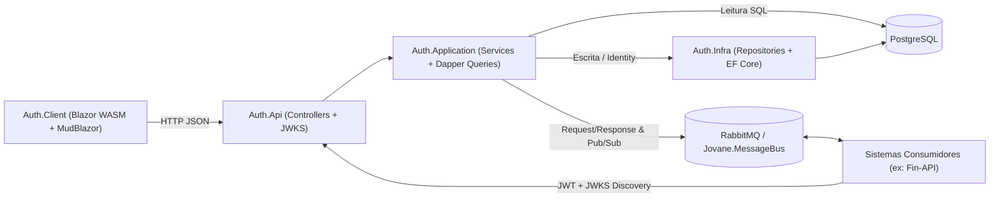
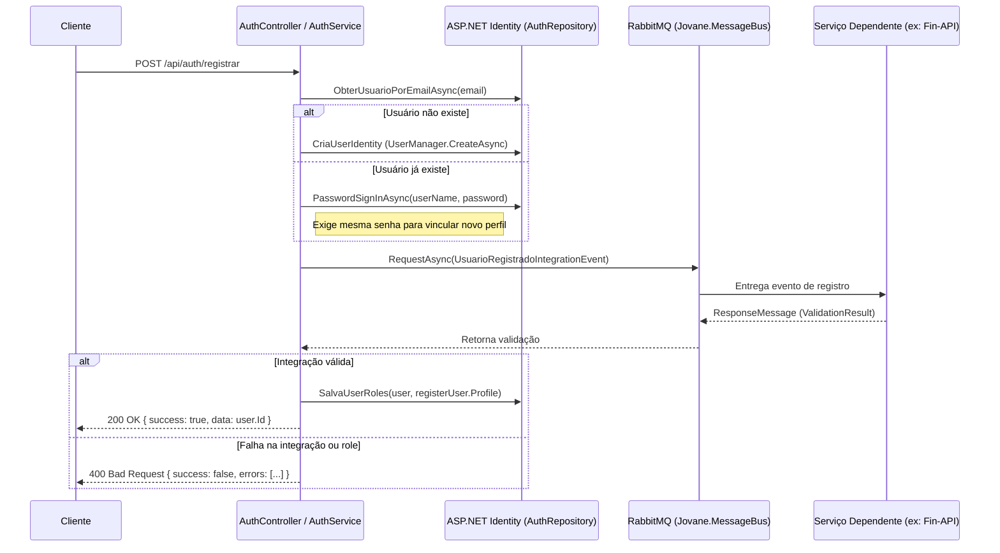

# Mapeamento de Fluxos e Arquitetura — Auth

Este documento detalha os fluxos existentes na solution `auth.sln`, suas camadas, integrações externas e pontos de atenção.

---

## 1. Visão Arquitetural

### Padrão de Resposta HTTP (`ApiController.CustomResponse`)
Todas as actions que usam `CustomResponse(...)` retornam:
- **Sucesso (`200 OK`):** `{ "success": true, "data": <payload> }`
- **Erro de validação/negócio (`400 Bad Request`):** `{ "success": false, "errors": ["mensagem 1", ...] }`

---

## 2. Fluxo de Registro de Usuário (`POST /api/auth/registrar`)

**Entry point:** `AuthController.Registrar(RegisterUserViewModel)` -> `AuthService.AdicionarUsuarioAsync`

**Pontos de atenção:**
- Se o usuário for criado no Identity (`CriaUserIdentity`) mas o `RequestAsync` no RabbitMQ falhar ou retornar inválido, o usuário permanece salvo no Identity sem a role associada (não há transação distribuída/compensação automática implementada).
- `EmailConfirmed` é definido como `true` na criação.

---

## 3. Fluxo de Login e Emissão de JWT (`POST /api/auth/login`)

**Entry point:** `AuthController.Login(LoginUserViewModel)` -> `AuthService.LogarUsuarioAsync`

1. Busca usuário por e-mail (`ObterUsuarioPorEmailAsync`).
2. Valida senha com `_signInManager.PasswordSignInAsync(..., lockoutOnFailure: true)` e executa `SignInAsync`.
3. Carrega claims das roles do usuário (`ObterClaimsPorUsuarioAsync` em `AspNetRoleClaims` via `AspNetUserRoles`).
4. **Validação de acesso ao sistema (`UsuarioTemPermissao`):** Verifica se existe ao menos uma claim com `Type == "permission"` cujo `Value` inicie com `loginUser.System.ToUpper()`.
5. Adiciona `ClaimTypes.NameIdentifier` com `user.Id`.
6. Gera JWT assinado com a chave atual do JWKS (`_jwksService.GetCurrentSigningCredentials()`):
   - `Issuer`: `{Request.Scheme}://{Request.Host}`
   - `Expires`: `DateTime.UtcNow.AddHours(1)`
7. Gera e persiste `RefreshToken` (`GUID`) em `RefreshTokens` (removendo tokens anteriores do mesmo `UserName`), com expiração em `_appTokenSettings.RefreshTokenExpiration` dias.
8. Retorna `CustomResponse(new { token = LoginResponseViewModel })`.

---

## 4. Fluxo de Refresh Token (`POST /api/auth/refresh-token`)

**Entry point:** `AuthController.RefreshToken(RefreshTokenRequestViewModel)` -> `AuthService.RefreshToken`

1. Valida se `RefreshToken` é um `Guid` válido e se `System` foi informado.
2. Busca o registro na tabela `RefreshTokens` (`AsNoTracking`) e valida `tokenPersisted.isValid()` (`ExpirationDate > DateTime.UtcNow`).
3. Revalida claims e permissão para o sistema (`MountUserClaims`), gera novo JWT e rotaciona o `RefreshToken` (`GenerateRefreshToken`).
4. Retorna `CustomResponse(new { token = LoginResponseViewModel })`.

---

## 5. Fluxo de Recuperação de Senha

### 5.1 Solicitação (`POST /api/auth/forgot-password`)
1. Busca usuário por e-mail; se não existir ou não tiver e-mail confirmado, retorna `true` silenciosamente (evita enumeração de usuários).
2. Gera token de reset via `UserManager.GeneratePasswordResetTokenAsync`.
3. Monta URL `{FrontEndSettings.AllowedApps[0]}/auth?email={email}&token={token}` (com `Uri.EscapeDataString`).
4. Publica `EmailIntegrationEvent` (`Type = "RESET"`) no RabbitMQ via `_messageBus.PublishAsync`.

### 5.2 Redefinição (`POST /api/auth/reset-pass`)
1. Valida e-mail, existência do usuário, senha e token.
2. Executa `UserManager.ResetPasswordAsync` via `_authRepository.ResetarSenha`.

---

## 6. Fluxo de Gestão de Usuários

| Endpoint | Autorização | Fluxo / Origem dos Dados |
| :--- | :--- | :--- |
| `GET /api/auth/listar-usuarios` | `[ClaimsAuthorize("AUTH:LER")]` | `AuthQueryService.ObterUsuariosComSistemas()` via **Dapper** (`AspNetUsers` LEFT JOIN `AspNetUserRoles`, `AspNetRoles`, `SystemEntity`). |
| `GET /api/auth/details-user/{id}` | `[ClaimsAuthorize("AUTH:LER")]` | `AuthQueryService.ObterUsuarioPorId(id)` via **Dapper**. |
| `DELETE /api/auth/excluir/{id}` | `[ClaimsAuthorize("AUTH:LER")]` | `AuthService.RemoverUsuarioAsync(id)` -> `AuthRepository.DeleteAsync` (remove `RefreshTokens` do usuário e exclui via `UserManager.DeleteAsync`). |

---

## 7. Fluxo de Gestão de Sistemas, Roles e Claims (`/api/sistema`)

**Controller:** `SistemaController` (protegida por `[Authorize]` e `[ClaimsAuthorize("AUTH:LER")]`).

- **Sistemas:**
  - `POST /api/sistema`: valida `SystemEntity` e persiste via `SystemRepository`.
  - `GET /api/sistema`: consulta sistemas + roles + claims via **Dapper** (`SystemQueryService.ObterSistemasComPermissoes()`).
  - `PUT /api/sistema`: atualiza `Name` e `Url` de `SystemEntity`.
  - `DELETE /api/sistema/{id}`: remove `SystemEntity` caso não possua roles associadas (`SystemService.RemoveSistemaAsync`).
  - `GET /api/sistema/{id}/usuarios`: consulta usuários e roles vinculados ao sistema via **Dapper** (`SystemQueryService.ObterUsuariosPorSistema`).
- **Roles (`ApplicationRole`):**
  - `POST /api/sistema/roles`: adiciona role vinculada a `SystemId` (índice único `(SystemId, Name)`).
  - `DELETE /api/sistema/roles/remover/{roleId}`: impede exclusão se a role possuir claims associadas; caso contrário remove via `RoleManager`.
- **Claims (`permission`):**
  - `POST /api/sistema/claim`: adiciona `Claim("permission", value)` à role via `RoleManager.AddClaimAsync`.
  - `DELETE /api/sistema/claim/excluir/{roleId}/{claimValue}`: remove `Claim("permission", claimValue)` da role.

---

## 8. Fluxo do Frontend (`Src/Auth.Client`)

- **Tecnologia:** Blazor WebAssembly + MudBlazor.
- **Comunicação:** `ApiService` (`IApiService`) encapsula `HttpClient` deserializando `ResponsePayload<T>` e `ResponseError<string[]>` para `ApiResult<T>`.
- **Páginas principais:**
  - `Pages/Users.razor` + `Dialogs/CreateUserDialog.razor`, `DetailUserDialog.razor`
  - `Pages/Systems.razor` + `Dialogs/CreateSystemDialog.razor`, `SistemaDialog.razor`, `CreateRoleDialog.razor`, `RoleDialog.razor`
- **Hospedagem:** Em produção (`Dockerfile`), o build do `Auth.Client` é copiado para `./wwwroot` da `Auth.Api` e servido via `UseStaticFiles()` + `MapFallbackToFile("index.html")`.
